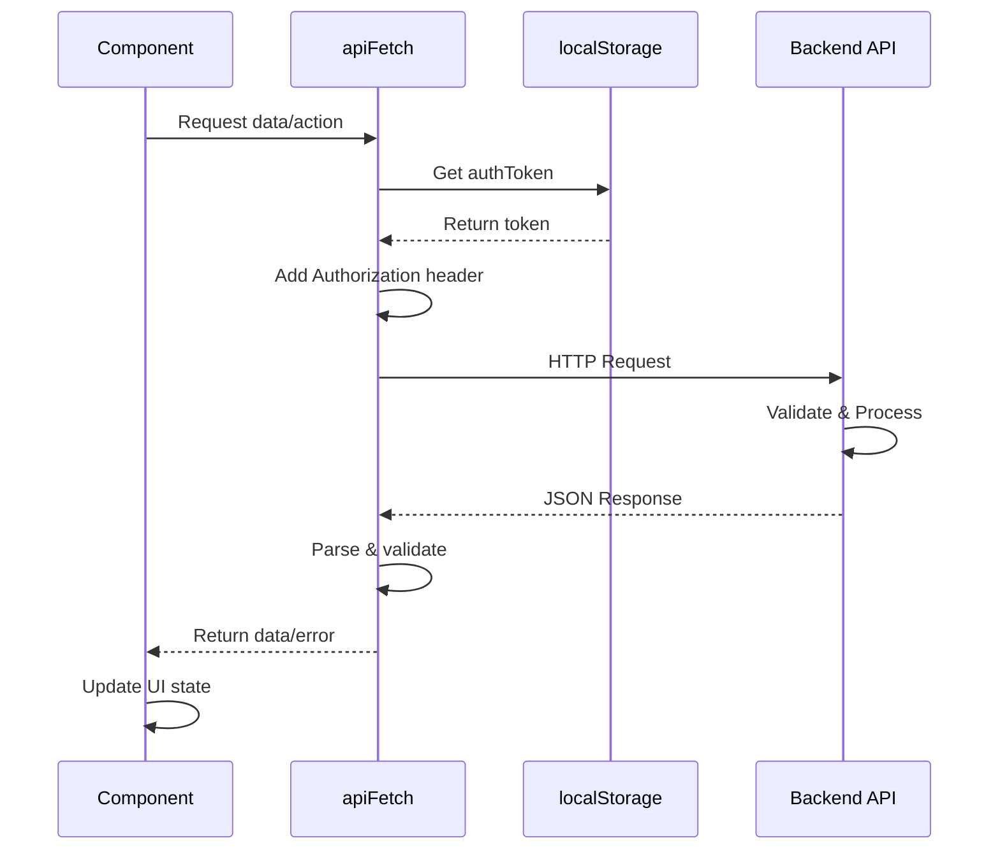
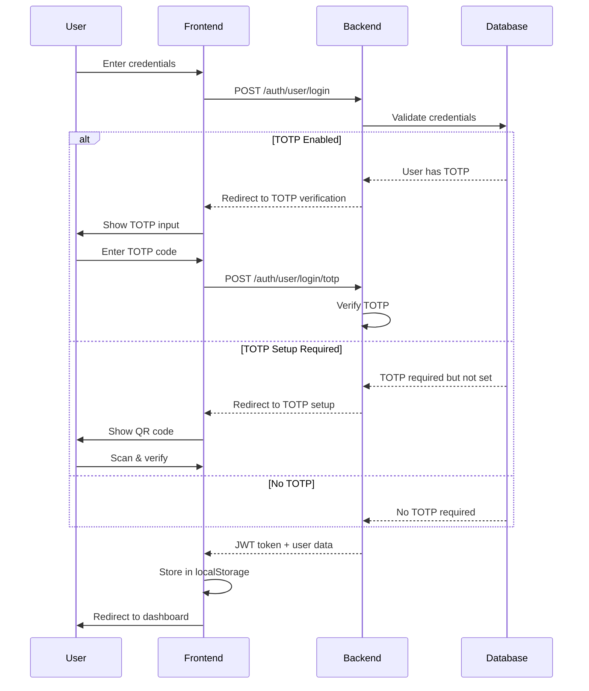
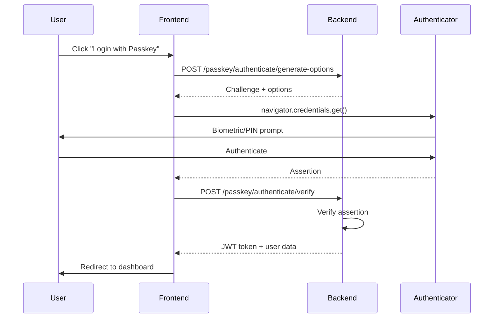
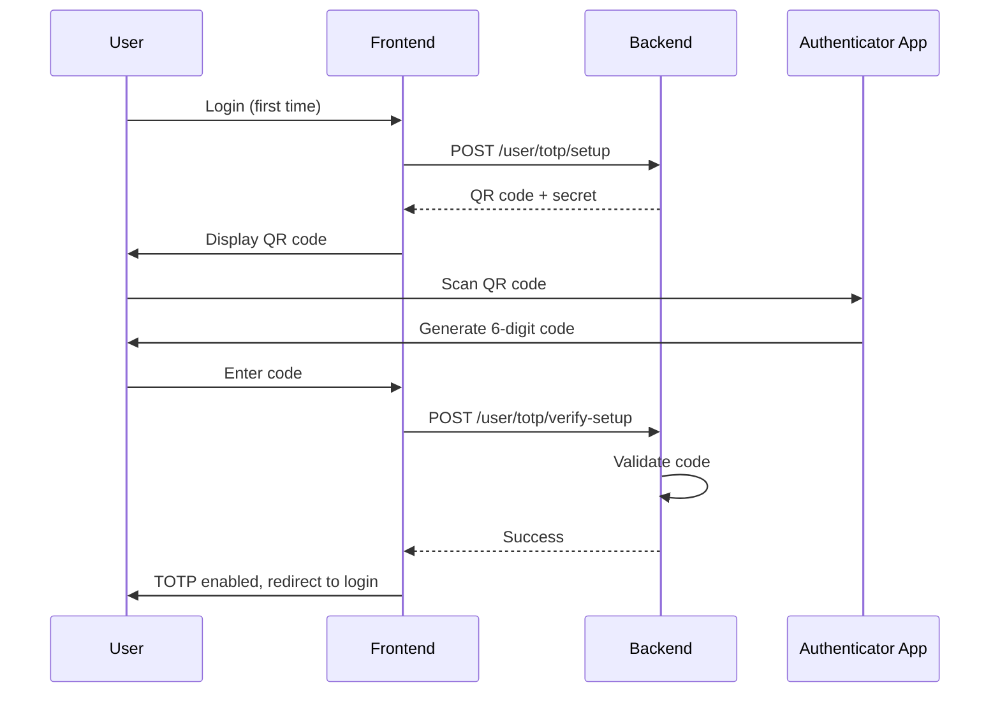

# 🛡️ DLP Frontend - Data Loss Prevention Dashboard

<div align="center">


**A comprehensive, modern web application for data loss prevention and enterprise security management.**

[Features](#-key-features) • [Installation](#-installation--setup) • [Documentation](#-technical-architecture) • [Contributing](#-contributing)

</div>

---

## 🌟 Overview

The DLP Dashboard is an enterprise-grade security platform that provides comprehensive tools for:

- 🔐 **Secure Authentication** - Multi-factor authentication with TOTP, Passkeys, and OAuth
- 👥 **User Management** - Complete lifecycle management with role-based access control
- 📱 **Device Monitoring** - Real-time device tracking and policy enforcement
- 📊 **Analytics & Reporting** - Comprehensive dashboards with actionable insights
- 🔒 **Data Protection** - Advanced DLP policies to prevent unauthorized data exfiltration

---

## 🚀 Key Features

### 🔐 Authentication & Security

<details>
<summary><b>Multi-Factor Authentication (MFA)</b></summary>

- **TOTP (Time-based One-Time Password)**
  - Secure 2FA setup with QR code generation
  - Compatible with Google Authenticator, Authy, and other authenticator apps
  - Manual entry key fallback for accessibility
  - Session-based setup flow with temporary tokens
  - Automatic token expiration and validation

- **Passkey Support (WebAuthn/FIDO2)**
  - Passwordless authentication using biometrics or security keys
  - Device-bound credentials for enhanced security
  - Multiple passkey registration per user
  - Last usage tracking and management
  - Cross-platform compatibility (Windows Hello, Face ID, Touch ID)

- **JWT-based Sessions**
  - Secure token management with automatic expiration
  - Token refresh mechanism
  - Client-side token validation
  - Secure localStorage with fallback mechanisms

- **Role-Based Access Control (RBAC)**
  - Granular permission system
  - Admin and User role separation
  - Protected routes with automatic redirection
  - Context-based authentication state management

</details>

<details>
<summary><b>Google OAuth Integration</b></summary>

- Single Sign-On (SSO) capability
- Seamless user onboarding
- Profile information synchronization

</details>

---

### 👨‍💼 Admin Features

<details>
<summary><b>Dashboard & Analytics</b></summary>

#### Real-time Statistics Dashboard
- **User Metrics**
  - Total active users
  - New user registrations
  - User activity trends
  
- **Device Statistics**
  - Total registered devices
  - Active device count
  - Device compliance status
  
- **Group Management**
  - User group overview
  - Group membership statistics
  - Group policy distribution

#### System Overview
- Parallel data fetching for optimal performance
- Loading states with visual indicators (Commet loader)
- Error handling with user-friendly messages
- Responsive grid layout for statistics cards

</details>

<details>
<summary><b>User Management</b></summary>

#### Complete User Lifecycle
- **Create Users**
  - Individual user creation with detailed form
  - Username, email, and role assignment
  - Password generation or custom password
  - Initial access setup
  
- **Edit Users**
  - Update user information
  - Modify roles and permissions
  - Enable/disable user accounts
  - Password reset functionality

- **Delete Users**
  - Safe user deletion with confirmation
  - Cascading deletion handling
  - Audit trail maintenance

#### Bulk Operations
- **CSV Import/Export**
  - Mass user creation via CSV upload
  - Template download for correct formatting
  - Validation and error reporting
  - Progress tracking for large imports
  - Export user data for reporting

#### Advanced Features
- **User Search & Filter**
  - Real-time search across user attributes
  - Filter by role, status, and group
  - Sortable columns (name, email, created date)
  
- **User Modal**
  - Quick view user details
  - Inline editing capabilities
  - Action buttons (edit, delete, reset password)
  
- **Checkbox Selection**
  - Multi-select for bulk operations
  - Select all/deselect all functionality
  - Bulk action menu

</details>

<details>
<summary><b>User Group Management</b></summary>

#### Group Operations
- **Create Groups**
  - Custom group naming
  - Description and metadata
  - Initial member assignment
  
- **Group Membership**
  - Add/remove users from groups
  - View group members list
  - Member count tracking
  - Nested group support

#### Group Navigation
- Dynamic routing to group details
- Member management interface
- Group-based policy application

</details>

<details>
<summary><b>Device Management</b></summary>

#### Device Features
- Device registration and tracking
- Device overview page with sidebar
- Device logs and activity monitoring
- Device profile management
- Device settings and configuration
- Compliance reporting

</details>

---

### 👤 User Features

<details>
<summary><b>Applications Dashboard</b></summary>

#### Application Catalog
- **Visual Application Grid**
  - Logo display with fallback initials
  - Clean card-based layout
  - Responsive grid (2-4 columns based on screen size)

#### Search & Filter
- **Real-time Search**
  - Instant search as you type
  - Case-insensitive matching
  - Search icon indicator
  
- **Favorites System**
  - Star/unstar applications
  - Favorites tab for quick access
  - Favorite count in tab badge

#### Pre-configured Applications
- AWS Cloud
- Google Chrome
- Mozilla Firefox
- Notion
- Motrix
- Visual Studio Code
- Figma
- Slack

</details>

<details>
<summary><b>Passkey Management</b></summary>

#### Passkey Features
- **Register Passkey**
  - One-click registration
  - Browser-native biometric prompt
  - Automatic device detection
  
- **View Registered Passkeys**
  - Credential ID display (truncated for security)
  - Device type information
  - Registration date
  - Last used timestamp
  - Sortable table view

- **Delete Passkeys**
  - Individual passkey removal
  - Confirmation dialog
  - Immediate UI update
  - Toast notifications for success/error

</details>

<details>
<summary><b>Profile & Settings</b></summary>

- Personal profile management
- Update contact information
- Security preferences
- Password change
- Session management
- Activity history

</details>

---

## 🛠 Technical Architecture

### Frontend Stack

```
┌─────────────────────────────────────────────────────────┐
│                     Next.js 15.1.1                       │
│              (App Router + Server Components)            │
├─────────────────────────────────────────────────────────┤
│                      React 19.0.0                        │
│           (Client Components + Hooks + Context)          │
├─────────────────────────────────────────────────────────┤
│                   TypeScript 5.0+                        │
│              (Type Safety + Interfaces)                  │
├─────────────────────────────────────────────────────────┤
│              Tailwind CSS 3.4 + Radix UI                │
│         (Responsive Design + Accessible Components)      │
└─────────────────────────────────────────────────────────┘
```

### Key Dependencies

| Package | Version | Purpose |
|---------|---------|---------|
| `next` | 15.1.1 | React framework with SSR/SSG |
| `react` | 19.0.0 | UI library |
| `typescript` | 5.0+ | Type safety |
| `tailwindcss` | 3.4.1 | Utility-first CSS |
| `@simplewebauthn/browser` | 13.2.0 | WebAuthn/Passkey support |
| `otplib` | 12.0.1 | TOTP generation/validation |
| `jwt-decode` | 4.0.0 | JWT token decoding |
| `react-hot-toast` | 2.5.2 | Toast notifications |
| `lucide-react` | 0.469.0 | Icon library |
| `@radix-ui/*` | Latest | Accessible UI primitives |

### Project Structure

```
dlp-frontend/
├── src/
│   ├── app/                      # Next.js App Router
│   │   ├── admin/               # Admin-only pages
│   │   │   ├── dashboard/       # Analytics dashboard
│   │   │   ├── users/           # User management
│   │   │   ├── user-groups/     # Group management
│   │   │   └── device/          # Device management
│   │   ├── auth/                # Authentication pages
│   │   │   ├── user/login/      # User login
│   │   │   ├── admin/login/     # Admin login
│   │   │   ├── totp-setup/      # 2FA setup
│   │   │   └── verify-totp/     # 2FA verification
│   │   ├── user/                # User dashboard
│   │   │   ├── applications/    # App catalog
│   │   │   ├── passkey/         # Passkey management
│   │   │   ├── profile/         # User profile
│   │   │   └── settings/        # User settings
│   │   ├── layout.tsx           # Root layout
│   │   ├── page.tsx             # Home page
│   │   └── globals.css          # Global styles
│   │
│   ├── components/              # Reusable components
│   │   ├── admin/              # Admin components
│   │   │   ├── UserList.tsx    # User table
│   │   │   ├── CreateUserForm.tsx
│   │   │   ├── EditUserForm.tsx
│   │   │   ├── CSVImportForm.tsx
│   │   │   ├── UserGroupList.tsx
│   │   │   └── UserModal.tsx
│   │   ├── user/               # User components
│   │   │   └── passkey.tsx     # Passkey utilities
│   │   ├── ui/                 # UI primitives
│   │   │   ├── button.tsx
│   │   │   ├── input.tsx
│   │   │   ├── sidebar.tsx
│   │   │   └── ...
│   │   ├── NavbarAdmin.tsx
│   │   ├── NavbarUser.tsx
│   │   ├── SideNavBarAdmin.tsx
│   │   └── PrivateRoute.tsx    # Route protection
│   │
│   ├── context/                # React Context
│   │   └── AuthContext.tsx     # Auth state management
│   │
│   ├── hooks/                  # Custom hooks
│   │   ├── use-mobile.tsx      # Mobile detection
│   │   └── use-hydration.tsx   # SSR hydration
│   │
│   ├── lib/                    # Utilities
│   │   ├── apiFetch.ts         # API client
│   │   ├── utils.ts            # Helper functions
│   │   └── date-utils.ts       # Date formatting
│   │
│   ├── types/                  # TypeScript types
│   │   ├── admin.types.ts
│   │   └── user.types.ts
│   │
│   └── middleware.ts           # Next.js middleware
│
├── public/                     # Static assets
├── package.json               # Dependencies
├── tsconfig.json             # TypeScript config
├── tailwind.config.ts        # Tailwind config
├── next.config.ts            # Next.js config
└── README.md                 # Documentation
```

---

## 🔌 API Integration

### API Request Flow



### Core API Endpoints

#### Authentication Endpoints

| Method | Endpoint | Description |
|--------|----------|-------------|
| `POST` | `/api/auth/user/login` | User authentication |
| `POST` | `/api/auth/admin/login` | Admin authentication |
| `POST` | `/api/auth/google/login` | Google OAuth login |
| `POST` | `/api/user/totp/setup` | Initialize TOTP setup |
| `POST` | `/api/user/totp/verify-setup` | Verify TOTP setup |
| `POST` | `/api/auth/user/login/totp` | Login with TOTP |
| `POST` | `/api/passkey/register/generate-options` | Generate passkey registration options |
| `POST` | `/api/passkey/register/verify` | Verify passkey registration |
| `POST` | `/api/passkey/authenticate/generate-options` | Generate passkey auth options |
| `POST` | `/api/passkey/authenticate/verify` | Verify passkey authentication |

#### Admin Management Endpoints

| Method | Endpoint | Description |
|--------|----------|-------------|
| `GET` | `/api/user` | List all users |
| `POST` | `/api/user` | Create new user |
| `GET` | `/api/user/{id}` | Get user details |
| `PUT` | `/api/user/{id}` | Update user |
| `DELETE` | `/api/user/{id}` | Delete user |
| `POST` | `/api/user/{id}/reset-password` | Reset user password |
| `GET` | `/api/user-group` | List all user groups |
| `POST` | `/api/user-group` | Create user group |
| `GET` | `/api/user-group/{id}` | Get group details |
| `POST` | `/api/user-group/{id}/members` | Add group members |
| `DELETE` | `/api/user-group/{id}/members/{userId}` | Remove group member |
| `GET` | `/api/device` | List all devices |
| `GET` | `/api/device/{id}/logs` | Get device logs |

#### User Endpoints

| Method | Endpoint | Description |
|--------|----------|-------------|
| `GET` | `/api/user/profile` | Get current user profile |
| `PUT` | `/api/user/profile` | Update user profile |
| `GET` | `/api/user/applications` | List available applications |
| `GET` | `/api/user/passkeys` | Get user's passkeys |
| `DELETE` | `/api/user/passkeys/{id}` | Delete passkey |

### apiFetch Utility

The centralized API client (`src/lib/apiFetch.ts`) provides:

**Features:**
- ✅ Automatic JWT token injection from localStorage
- ✅ Configurable base URL via environment variables
- ✅ Consistent error handling
- ✅ Type-safe response handling
- ✅ Support for all HTTP methods
- ✅ Header management

**Usage Example:**
```typescript
import { apiFetch } from '@/lib/apiFetch';

// GET request
const users = await apiFetch('/user');

// POST request
const newUser = await apiFetch('/user', {
  method: 'POST',
  headers: { 'Content-Type': 'application/json' },
  body: JSON.stringify(userData)
});

// PUT request
await apiFetch(`/user/${userId}`, {
  method: 'PUT',
  body: JSON.stringify(updates)
});

// DELETE request
await apiFetch(`/user/${userId}`, {
  method: 'DELETE'
});
```

---

## 📦 Installation & Setup

### Prerequisites

- **Node.js** 18.0.0 or higher
- **pnpm** (recommended) or npm
- **Backend API** server running (separate repository)

### Environment Configuration

Create a `.env.local` file in the project root:

```bash
# Backend API Configuration (Required)
NEXT_PUBLIC_API_BASE_URL=http://localhost:5000

# Optional: Application URL
NEXT_PUBLIC_APP_URL=http://localhost:3030

# Optional: OAuth Configuration
GOOGLE_CLIENT_ID=your_google_client_id
GOOGLE_CLIENT_SECRET=your_google_client_secret
```

For production, create `.env.production`:

```bash
NEXT_PUBLIC_API_BASE_URL=https://api.yourdomain.com
NEXT_PUBLIC_APP_URL=https://yourdomain.com
```

### Installation Steps

```bash
# Clone the repository
git clone https://github.com/letsbld/dlp-frontend.git
cd dlp-frontend

# Install dependencies
pnpm install

# Start development server
pnpm dev

# The application will start at http://localhost:3030
```

### Development Commands

```bash
# Development
pnpm dev              # Start dev server with Turbopack on port 3030

# Production
pnpm build            # Build for production
pnpm start            # Start production server

# Code Quality
pnpm lint             # Run ESLint

# Type Checking
npx tsc --noEmit      # Check TypeScript types
```

### Port Configuration

The application runs on port **3030** by default. To change this:

**Option 1: package.json**
```json
{
  "scripts": {
    "dev": "next dev --turbopack --port 3000",
    "start": "next start --port 3000"
  }
}
```

**Option 2: Command line**
```bash
pnpm dev -- --port 3000
```

---

## 🔒 Security Features

### Authentication Flows

#### 1️⃣ Standard Login Flow



#### 2️⃣ Passkey Authentication Flow



#### 3️⃣ TOTP Setup Flow



### Security Best Practices

✅ **Token Management**
- JWT tokens stored in localStorage
- Automatic token expiration checking
- Token validation on page load
- Secure token transmission

✅ **Route Protection**
- `PrivateRoute` component for role-based access
- Automatic redirection for unauthorized access
- Client-side and middleware protection

✅ **Input Validation**
- Client-side validation before submission
- Type-safe forms with TypeScript
- Sanitized user inputs

✅ **API Security**
- Authorization header on all requests
- CORS configuration
- Rate limiting (backend)
- SQL injection prevention (backend)

---

## 🚀 Deployment

### Vercel (Recommended)

[](https://vercel.com/new)

1. **Connect Repository**
   - Import your GitHub repository to Vercel
   - Select the `dlp-frontend` project

2. **Configure Environment Variables**
   ```
   NEXT_PUBLIC_API_BASE_URL=https://your-api-domain.com
   ```

3. **Deploy**
   - Vercel will automatically build and deploy
   - Subsequent pushes to main branch auto-deploy

### Docker Deployment

**Dockerfile:**
```dockerfile
# Stage 1: Build
FROM node:18-alpine AS builder
WORKDIR /app

# Install dependencies
COPY package.json pnpm-lock.yaml ./
RUN npm install -g pnpm && pnpm install --frozen-lockfile

# Build application
COPY . .
RUN pnpm build

# Stage 2: Production
FROM node:18-alpine AS runner
WORKDIR /app

ENV NODE_ENV=production
ENV NEXT_TELEMETRY_DISABLED=1

# Copy built files
COPY --from=builder /app/next.config.ts ./
COPY --from=builder /app/public ./public
COPY --from=builder /app/.next/standalone ./
COPY --from=builder /app/.next/static ./.next/static

EXPOSE 3030

CMD ["node", "server.js"]
```

**Build & Run:**
```bash
# Build image
docker build -t dlp-frontend:latest .

# Run container
docker run -p 3030:3030 \
  -e NEXT_PUBLIC_API_BASE_URL=https://api.yourdomain.com \
  dlp-frontend:latest
```

**Docker Compose:**
```yaml
version: '3.8'

services:
  frontend:
    build: .
    ports:
      - "3030:3030"
    environment:
      - NEXT_PUBLIC_API_BASE_URL=http://backend:5000
    depends_on:
      - backend
    restart: unless-stopped

  backend:
    image: dlp-backend:latest
    ports:
      - "5000:5000"
    environment:
      - DATABASE_URL=postgresql://user:pass@db:5432/dlp
    restart: unless-stopped
```

### Manual Deployment (VPS/Server)

```bash
# On your server
git clone https://github.com/letsbld/dlp-frontend.git
cd dlp-frontend

# Install dependencies
pnpm install

# Build
pnpm build

# Use PM2 for process management
npm install -g pm2
pm2 start npm --name "dlp-frontend" -- start
pm2 save
pm2 startup

# Setup Nginx reverse proxy
sudo nano /etc/nginx/sites-available/dlp-frontend
```

**Nginx Configuration:**
```nginx
server {
    listen 80;
    server_name yourdomain.com;

    location / {
        proxy_pass http://localhost:3030;
        proxy_http_version 1.1;
        proxy_set_header Upgrade $http_upgrade;
        proxy_set_header Connection 'upgrade';
        proxy_set_header Host $host;
        proxy_cache_bypass $http_upgrade;
    }
}
```

---

## 🔄 Recent Improvements & Enhancements

### ⚡ Performance Optimizations

#### Parallel Data Fetching
- **Admin Dashboard**: All statistics fetched simultaneously using `Promise.all`
- **Reduced Load Time**: 3x faster dashboard loading
- **Better User Experience**: Immediate visual feedback with loading states

```typescript
// Before: Sequential (slow)
const users = await apiFetch('/user/');
const devices = await apiFetch('/device');
const groups = await apiFetch('/user-group');

// After: Parallel (fast)
const [users, devices, groups] = await Promise.all([
  apiFetch('/user/'),
  apiFetch('/device'),
  apiFetch('/user-group')
]);
```

#### Component Optimization
- Lazy loading for heavy components
- Memoization of expensive computations
- Efficient re-render prevention
- Optimized image loading with Next.js Image

### 🎨 User Experience Enhancements

#### Visual Feedback
- **Loading Indicators**: Beautiful Commet loader for all async operations
- **Toast Notifications**: Instant feedback for user actions
- **Error States**: User-friendly error messages
- **Empty States**: Helpful guidance when no data exists

#### Responsive Design
- Mobile-first approach with Tailwind CSS
- Adaptive layouts for all screen sizes
- Touch-friendly interfaces
- Collapsible sidebars for mobile

#### Search & Filter
- **Real-time Application Search**: Instant results as you type
- **Smart Filtering**: Case-insensitive search
- **Visual Search Indicator**: Clear search icon
- **No Results State**: Helpful empty state

### 🔐 Security Improvements

#### Enhanced Authentication
- **Multiple Auth Methods**: Username/Password, TOTP, Passkeys, OAuth
- **Session Management**: Automatic token expiration and refresh
- **Secure Storage**: Encrypted localStorage with validation

#### Input Validation
- Client-side validation before API calls
- TypeScript type checking
- Sanitized inputs to prevent XSS
- CSRF protection

#### Passkey Support
- Modern passwordless authentication
- Biometric authentication support
- Device-bound credentials
- Platform authenticator support

### 🏗️ Code Quality Improvements

#### TypeScript Integration
- **Full Type Safety**: All components and functions typed
- **Interface Definitions**: Clear contracts for data structures
- **Type Inference**: Reduced boilerplate with smart inference
- **Strict Mode**: Catch errors early in development

#### Component Architecture
- **Reusable Components**: DRY principle throughout codebase
- **Consistent Styling**: Unified design system with Tailwind
- **Props Interfaces**: Clear component APIs
- **Separation of Concerns**: Logic separated from presentation

#### Error Handling
- Try-catch blocks for all async operations
- Graceful degradation on failures
- User-friendly error messages
- Error boundaries for component crashes

#### Code Organization
```
✅ Clear folder structure
✅ Modular components
✅ Centralized utilities
✅ Consistent naming conventions
✅ Comprehensive documentation
```

### 📱 New Features Added

#### Application Dashboard
- Visual application catalog with logos
- Favorites system with persistent state
- Real-time search functionality
- Responsive grid layout
- Tab-based navigation (All/Favorites)

#### Passkey Management
- Register new passkeys
- View all registered passkeys
- Delete passkeys with confirmation
- Display credential details
- Last usage tracking

#### User Group Management
- Create and manage user groups
- Add/remove group members
- Navigate to group details
- View member lists
- Group-based policies

#### CSV Import/Export
- Bulk user import from CSV
- Template download
- Validation and error reporting
- Progress tracking
- Export functionality

---

## 🧪 Testing

### Component Testing
```bash
# Run tests (when configured)
pnpm test

# Run tests in watch mode
pnpm test:watch

# Generate coverage report
pnpm test:coverage
```

### Manual Testing Checklist

- [ ] User login with username/password
- [ ] Admin login flow
- [ ] TOTP setup and verification
- [ ] Passkey registration
- [ ] Passkey authentication
- [ ] User creation/editing/deletion
- [ ] User group management
- [ ] CSV import functionality
- [ ] Application search and favorites
- [ ] Responsive design on mobile
- [ ] Token expiration handling
- [ ] Error state handling

---

## 🤝 Contributing

We welcome contributions! Please follow these guidelines:

### Development Workflow

1. **Fork the repository**
   ```bash
   git clone https://github.com/your-username/dlp-frontend.git
   ```

2. **Create a feature branch**
   ```bash
   git checkout -b feature/amazing-feature
   ```

3. **Make your changes**
   - Follow the existing code style
   - Add TypeScript types
   - Update documentation
   - Test thoroughly

4. **Commit your changes**
   ```bash
   git commit -m 'Add some amazing feature'
   ```

5. **Push to the branch**
   ```bash
   git push origin feature/amazing-feature
   ```

6. **Open a Pull Request**
   - Describe your changes
   - Link related issues
   - Request review

### Code Style Guidelines

- Use TypeScript for all new code
- Follow existing naming conventions
- Use functional components with hooks
- Keep components small and focused
- Add comments for complex logic
- Use Tailwind CSS for styling
- Ensure responsive design

### Commit Message Format

```
type(scope): subject

body

footer
```

Types: `feat`, `fix`, `docs`, `style`, `refactor`, `test`, `chore`

Example:
```
feat(auth): add passkey authentication

- Implement WebAuthn registration flow
- Add passkey management UI
- Update authentication context

Closes #123
```

---

## 📄 License

This project is **private and proprietary software**. All rights reserved.

© 2025 BLD. Unauthorized copying, modification, distribution, or use of this software is strictly prohibited.

---

## 🆘 Support & Contact

### Getting Help

- 📧 **Email**: support@yourdomain.com
- 💬 **Discord**: [Join our community](https://discord.gg/yourinvite)
- 📖 **Documentation**: [Full docs](https://docs.yourdomain.com)
- 🐛 **Bug Reports**: [GitHub Issues](https://github.com/letsbld/dlp-frontend/issues)

### FAQ

<details>
<summary><b>How do I reset my password?</b></summary>

Contact your administrator or use the "Forgot Password" link on the login page.
</details>

<details>
<summary><b>Can I use multiple passkeys?</b></summary>

Yes! You can register multiple passkeys for backup and convenience.
</details>

<details>
<summary><b>What browsers support passkeys?</b></summary>

Chrome 67+, Firefox 60+, Safari 13+, Edge 18+
</details>

<details>
<summary><b>How do I enable TOTP?</b></summary>

Your administrator can require TOTP. Once enabled, you'll be guided through setup on your next login.
</details>

---

## 🙏 Acknowledgments

- **Next.js Team** - Amazing React framework
- **Vercel** - Hosting and deployment platform
- **Radix UI** - Accessible component primitives
- **Tailwind Labs** - Beautiful utility-first CSS
- **SimpleWebAuthn** - WebAuthn implementation
- **All Contributors** - Thank you for your contributions!

---

## 📊 Project Stats


---

<div align="center">

**Built with ❤️ using Next.js, TypeScript, and modern web technologies**

[⬆ Back to Top](#️-dlp-frontend---data-loss-prevention-dashboard)

</div>
