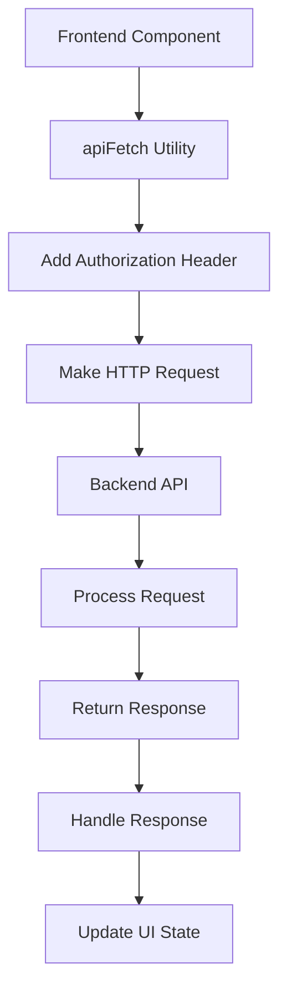

# Data Loss Prevention (DLP) Dashboard Frontend

A comprehensive, modern web application for data loss prevention and security monitoring. This Next.js-based dashboard provides administrators and users with powerful tools to manage, monitor, and protect sensitive organizational data.

## 🌟 Overview

The DLP Dashboard is designed to help organizations:

- **Monitor** data movement and access patterns in real-time
- **Manage** user accounts, groups, and device policies
- **Prevent** unauthorized data exfiltration and breaches
- **Analyze** security events and generate comprehensive reports
- **Authenticate** users securely with multiple methods including TOTP and Passkeys

## 🚀 Key Features

### 🔐 Authentication & Security

- **Multi-factor Authentication (MFA)**: TOTP setup and verification for enhanced security
- **Passkey Support**: Modern passwordless authentication using WebAuthn
- **JWT-based Sessions**: Secure token management with automatic expiration
- **Role-based Access Control**: Separate interfaces for admin and regular users
- **Google OAuth Integration**: Social login capabilities

### 👨‍💼 Admin Features

#### Dashboard & Analytics
- **Real-time Statistics**: User count, device count, and group statistics
- **System Overview**: Comprehensive view of DLP system status
- **Error Monitoring**: Built-in error handling and reporting

#### User Management
- **Complete User Lifecycle**: Create, edit, delete, and manage user accounts
- **Bulk Operations**: CSV import/export for mass user management
- **Password Management**: Secure password reset functionality
- **User Grouping**: Organize users into logical groups for policy management

#### Device Management
- **Device Registration**: Track and manage user devices
- **Device Monitoring**: Real-time device status and activity tracking
- **Policy Enforcement**: Apply DLP policies to registered devices
- **Device Logs**: Comprehensive logging of device activities

#### Reporting & Analytics
- **Security Reports**: Generate detailed security incident reports
- **Usage Analytics**: Track application and data usage patterns
- **Audit Trails**: Complete audit logs for compliance

### 👤 User Features

#### Applications Dashboard
- **Application Catalog**: Browse and manage approved applications
- **Search & Filter**: Find applications quickly with intelligent search
- **Favorites System**: Mark frequently used applications for easy access
- **Usage Tracking**: Monitor application usage patterns

#### Device Management
- **Device Settings**: Configure and manage personal devices
- **Security Policies**: View and comply with organizational policies
- **Activity Monitoring**: Track personal device security status

#### Profile & Settings
- **Profile Management**: Update personal information and preferences
- **Security Settings**: Manage authentication methods and security preferences
- **Passkey Setup**: Configure passwordless authentication

## 🛠 Technical Architecture

### Frontend Stack
- **Framework**: Next.js 15 with React 19
- **Language**: TypeScript for type safety
- **Styling**: Tailwind CSS with Radix UI components
- **State Management**: React Context API with custom hooks
- **Authentication**: JWT tokens with secure local storage

### API Integration

#### API Request Flow



#### Key API Endpoints

**Authentication:**
- `POST /api/auth/user/login` - User login
- `POST /api/auth/admin/login` - Admin login
- `POST /api/auth/user/totp-setup` - TOTP setup
- `POST /api/auth/user/verify-totp` - TOTP verification
- `POST /api/auth/passkey/login` - Passkey authentication

**Admin Management:**
- `GET /api/user/` - List all users
- `POST /api/user/` - Create new user
- `PUT /api/user/{id}` - Update user
- `DELETE /api/user/{id}` - Delete user
- `GET /api/user-group/` - List user groups
- `GET /api/device/` - List devices

**User Features:**
- `GET /api/user/profile` - Get user profile
- `PUT /api/user/profile` - Update profile
- `GET /api/user/applications` - List available applications
- `GET /api/user/device` - Get device information

#### API Utility Features

The `apiFetch` utility provides:
- **Automatic Token Management**: Attaches JWT tokens to requests
- **Error Handling**: Consistent error processing across the application
- **Loading States**: Built-in loading state management
- **Environment Configuration**: Flexible API base URL configuration

## 📦 Installation & Setup

### Prerequisites
- Node.js 18+
- npm or pnpm package manager
- Backend API server (separate repository)

### Environment Configuration

Create a `.env.local` file in the project root:

```bash
# Backend API Configuration
NEXT_PUBLIC_API_BASE_URL=http://localhost:5000

# Optional: Additional environment variables
# NEXT_PUBLIC_APP_URL=http://localhost:3000
```

For production, create `.env.production`:

```bash
NEXT_PUBLIC_API_BASE_URL=https://your-production-api.com
```

### Installation

```bash
# Install dependencies
npm install
# or
pnpm install

# Start development server
npm run dev
# or
pnpm dev

# Build for production
npm run build

# Start production server
npm start
```

The application will be available at `http://localhost:3000`

## 🔒 Security Features

### Authentication Flows

#### Standard Login Flow
1. User submits username/password
2. Server validates credentials
3. If TOTP enabled: redirect to TOTP verification
4. If TOTP setup required: redirect to TOTP setup
5. Return JWT token and user data
6. Store token in localStorage and redirect

#### Passkey Authentication Flow
1. User initiates passkey login
2. Browser prompts for biometric/device authentication
3. Server validates WebAuthn assertion
4. Return JWT token and redirect to appropriate dashboard

#### TOTP Setup Flow
1. User logs in with temporary token
2. Generate TOTP secret and QR code
3. User scans QR code in authenticator app
4. Verify setup with first TOTP code
5. Enable TOTP for account

## 🚀 Deployment

### Vercel (Recommended)

1. Connect your GitHub repository to Vercel
2. Configure environment variables in Vercel dashboard
3. Deploy automatically on git push

### Docker Deployment

```dockerfile
FROM node:18-alpine AS builder
WORKDIR /app
COPY package*.json ./
RUN npm ci --only=production

COPY . .
RUN npm run build

FROM node:18-alpine AS runner
WORKDIR /app
COPY --from=builder /app/next.config.js ./
COPY --from=builder /app/public ./public
COPY --from=builder /app/.next ./.next
COPY --from=builder /app/node_modules ./node_modules
COPY --from=builder /app/package.json ./package.json

EXPOSE 3000
CMD ["npm", "start"]
```

## 🔄 Recent Improvements

### Performance Enhancements
- **Optimized API Calls**: Parallel data fetching for dashboard statistics
- **Efficient State Management**: Reduced unnecessary re-renders
- **Image Optimization**: Next.js Image component for better performance

### User Experience
- **Responsive Design**: Mobile-first approach with Tailwind CSS
- **Loading States**: Visual feedback for all async operations
- **Error Handling**: User-friendly error messages and recovery options
- **Search Functionality**: Real-time application search and filtering

### Security Improvements
- **Enhanced Authentication**: Multiple authentication methods
- **Token Security**: Secure token storage and automatic expiration
- **Input Validation**: Client-side validation with server-side verification
- **Passkey Support**: Modern authentication for better security

### Code Quality
- **TypeScript Integration**: Full type safety across the application
- **Component Architecture**: Reusable UI components with consistent styling
- **Error Boundaries**: Graceful error handling at component level
- **Code Organization**: Clear separation of concerns and modular structure

## 🤝 Contributing

1. Fork the repository
2. Create a feature branch (`git checkout -b feature/amazing-feature`)
3. Commit your changes (`git commit -m 'Add some amazing feature'`)
4. Push to the branch (`git push origin feature/amazing-feature`)
5. Open a Pull Request

## 📄 License

This project is private and proprietary software. All rights reserved.

## 🆘 Support

For support and questions, please contact the development team or create an issue in the project repository.

---

**Built with ❤️ using Next.js, TypeScript, and modern web technologies**
