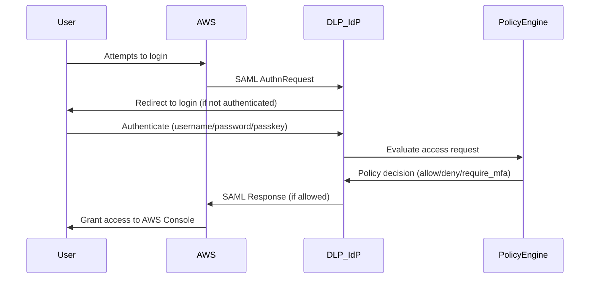

# SSO Identity Provider & DLP Integration

## Overview

This implementation transforms the DLP Dashboard into a comprehensive Single Sign-On (SSO) Identity Provider with Data Loss Prevention capabilities, similar to JumpCloud. Users attempting to access external services (AWS, Google Workspace, etc.) are redirected through our authentication system first.

## Architecture

### Core Components

1. **Identity Provider (IdP) Server**: Our DLP application acts as the central authentication authority
2. **Service Provider (SP) Integration**: External services (AWS, Google, etc.) configured to use our IdP
3. **DLP Policy Engine**: Monitors and controls access based on security policies
4. **Session Management**: Maintains user sessions across multiple services
5. **Audit & Compliance**: Logs all authentication and access events

### Authentication Flow



## Implementation

### Backend Services

#### SAML Identity Provider Service

- **File**: `src/backend/domains/sso/services/saml-idp-fixed.service.ts`
- **Purpose**: Handles SAML 2.0 protocol for SSO
- **Features**:
  - SAML metadata generation
  - Authentication request processing
  - SAML response generation with user attributes

#### DLP Policy Engine

- **File**: `src/backend/domains/sso/services/dlp-policy.service.ts`
- **Purpose**: Evaluates access requests against security policies
- **Features**:
  - Risk-based access control
  - Multi-factor authentication enforcement
  - Device trust evaluation
  - Time-based access restrictions

### API Endpoints

#### SAML Endpoints

- `GET /api/saml/metadata` - IdP metadata for service provider configuration
- `GET/POST /api/saml/sso/login` - Basic SAML SSO endpoint
- `GET/POST /api/saml/sso/protected-login` - DLP-protected SAML SSO endpoint

#### Management Interface

- `/dashboard/sso-management` - Admin interface for managing service providers and policies

### Frontend Components

#### SSO Management Dashboard

- **File**: `src/app/dashboard/sso-management/page.tsx`
- **Features**:
  - Service provider configuration
  - DLP policy management
  - Access audit logs
  - Metadata download

## Configuration

### Environment Variables

```env
# SAML Configuration
SAML_IDP_CERTIFICATE=your_certificate_here
SAML_SP_CERTIFICATE=service_provider_certificate
SAML_SP_PRIVATE_KEY=service_provider_private_key
WEBAUTHN_RP_ID=yourdomain.com
WEBAUTHN_ORIGIN=https://yourdomain.com
NEXT_PUBLIC_API_BASE_URL=https://yourdomain.com
```

### AWS SAML Configuration

1. **Download IdP Metadata**
   - Go to `/dashboard/sso-management`
   - Click "Download Metadata" button
   - Save the XML file

2. **Create SAML Identity Provider in AWS**

   ```bash
   # AWS CLI command
   aws iam create-saml-provider \
     --name DLPIdentityProvider \
     --saml-metadata-document file://dlp-idp-metadata.xml
   ```

3. **Create IAM Roles**

   ```json
   {
     "Version": "2012-10-17",
     "Statement": [
       {
         "Effect": "Allow",
         "Principal": {
           "Federated": "arn:aws:iam::YOUR_ACCOUNT:saml-provider/DLPIdentityProvider"
         },
         "Action": "sts:AssumeRoleWithSAML",
         "Condition": {
           "StringEquals": {
             "SAML:aud": "https://signin.aws.amazon.com/saml"
           }
         }
       }
     ]
   }
   ```

4. **Configure AWS Console URL**
   - Update your AWS login process to use:
   - `https://yourdomain.com/api/saml/sso/protected-login?sp=aws`

## DLP Policies

### Default Policies

#### AWS Admin Access Policy

- **Condition**: User has admin role AND MFA not verified
- **Action**: Require MFA authentication
- **Priority**: 1

#### Untrusted Device Block

- **Condition**: Device trust level is "untrusted"
- **Action**: Deny access and notify security team
- **Priority**: 2

#### High Risk Access Approval

- **Condition**: Risk score > 7
- **Action**: Require manual approval
- **Priority**: 3

#### Off Hours Monitoring

- **Condition**: Access outside business hours (9 AM - 5 PM)
- **Action**: Enhanced logging and notification
- **Priority**: 4

### Policy Components

#### Conditions

- **user_role**: Admin, user, etc.
- **device_trust**: Trusted, untrusted, unknown
- **location**: IP-based geolocation
- **time**: Time-based restrictions
- **risk_score**: Calculated risk (0-10)
- **mfa_verified**: MFA authentication status

#### Actions

- **allow**: Grant access
- **deny**: Block access
- **require_mfa**: Force MFA challenge
- **require_approval**: Manual approval workflow
- **log**: Enhanced logging
- **notify**: Send notifications

## Security Features

### Multi-Factor Authentication

- Integration with existing TOTP system
- Passkey/WebAuthn support for users
- Risk-based MFA enforcement

### Device Trust

- Device fingerprinting
- Trust level assignment
- Untrusted device blocking

### Risk Assessment

- Dynamic risk score calculation
- Multiple risk factors:
  - Device trust level
  - MFA verification status
  - User role and permissions
  - Time of access
  - Geolocation
  - Historical behavior

### Audit and Compliance

- Comprehensive access logging
- Policy decision tracking
- Risk score recording
- Compliance reporting

## Usage Examples

### User Login Flow

1. **User accesses AWS Console**

   ```
   https://console.aws.amazon.com/
   ```

2. **AWS redirects to DLP IdP**

   ```
   https://yourdomain.com/api/saml/sso/protected-login?SAMLRequest=...
   ```

3. **DLP evaluates access**
   - User authentication
   - Policy evaluation
   - Risk assessment

4. **Access granted with monitoring**

   ```
   User redirected to AWS Console with SAML assertion
   All actions logged and monitored
   ```

### Admin Configuration

1. **Add new service provider**
   - Navigate to SSO Management
   - Click "Add Provider"
   - Configure SAML settings

2. **Create custom policy**
   - Go to DLP Policies tab
   - Define conditions and actions
   - Set priority level

3. **Monitor access**
   - Review audit logs
   - Analyze risk patterns
   - Adjust policies as needed

## Testing

### Development Testing

```bash
# Start development server
pnpm run dev

# Access SSO management
https://localhost:3000/dashboard/sso-management

# Test SAML metadata
https://localhost:3000/api/saml/metadata
```

### Production Deployment

- Ensure HTTPS is enabled (required for SAML)
- Configure proper certificates
- Set up monitoring and alerting
- Test with actual service providers

## Troubleshooting

### Common Issues

1. **SAML Signature Verification Fails**
   - Check certificate configuration
   - Verify metadata accuracy
   - Ensure clock synchronization

2. **Policy Not Triggering**
   - Check policy conditions
   - Verify user attributes
   - Review policy priority

3. **Access Denied Unexpectedly**
   - Review audit logs
   - Check risk score calculation
   - Verify policy conditions

### Debug Mode

Enable detailed logging in development:

```env
NODE_ENV=development
DEBUG=saml,dlp-policy
```

## Future Enhancements

### Phase 1 (Current)

- ✅ SAML 2.0 Identity Provider
- ✅ Basic DLP policy engine
- ✅ AWS integration
- ✅ Management interface

### Phase 2 (Planned)

- OAuth 2.0/OpenID Connect support
- Google Workspace integration
- Microsoft 365 integration
- Advanced device fingerprinting

### Phase 3 (Future)

- Machine learning risk assessment
- Behavioral analytics
- Zero-trust architecture
- API access control

### Phase 4 (Advanced)

- SCIM user provisioning
- Just-in-time access
- Privileged access management
- Compliance automation

## Support

For implementation support or questions:

1. Review the troubleshooting guide
2. Check audit logs for error details
3. Consult SAML and OAuth specifications
4. Contact security team for policy questions
